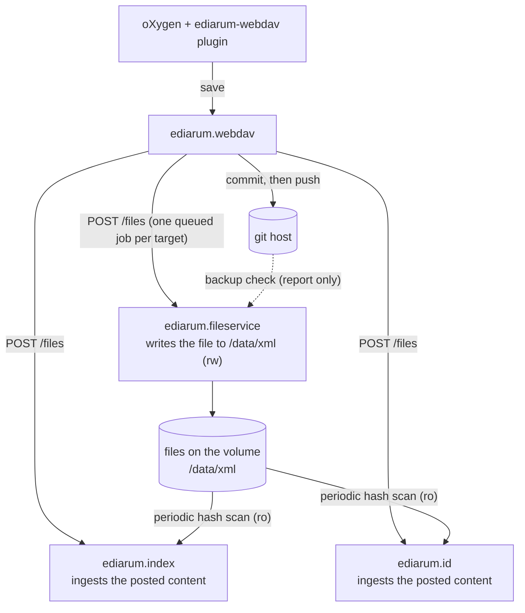

# ediarum.fileservice

Keeps the XML of each project on the shared volume (`/data/xml/<slug>`)
in step with `ediarum.webdav` and git. It is the only service that writes to
the volume and the only one that runs git.

## How it fits into the platform

## Where to read on

| If you want to… | Read |
|---|---|
| deploy or run it | [Operate](operate/deploy.md) |
| work on the code | [Develop](develop/index.md) |
| know why it works this way | [Design](concepts/design.md) · [webdav-led sync](concepts/webdav-led-sync.md) |
| look up a route, setting or command | [Reference](reference/routes.md) |
| read a module's or function's docstring | [Python API](api/index.md) |
